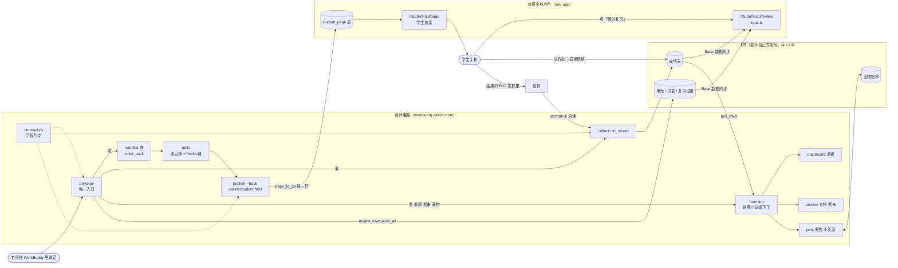

# 背单词闯关：工程说明

老师的问题是「检查学生落实很头疼」。这个工程给的不是一个检查器，是一条闭环：老师在 WorkBuddy 里说话 → 学生在手机上闯关 → 成绩回到飞书 → 看板和每个人的复习单 → 下一课。

老师在这中间只说两句话：「这周学 Unit 3」和「收一下作业」。

数据结构为什么是这样，见 [feishu/00_数据结构设计.md](feishu/00_数据结构设计.md)。

## 架构



### 一次作答的数据怎么走

1. **发**：词表.md 先用 `wordlist.py 查` 检查，再由 `build_pack` 生成 pack.json，`units` 把它加进课目录。`publish --book` 把整个课目录、名单、表单地址和复习接口地址一起塞进 `assets/student.html`，得到一个网页。`page_to_db` 把这个网页插进妙搭应用库，学生链接不变，读到的永远是最新一版。同时 `review_rows` 把单元和词表写进飞书，后端靠这两张表算复习单。
2. **做**：学生在页面上选名字、做题。`judge()` 给每题判出 pass / near / fail / review，明细按「题号:结果」记，还不会和差一点的题用 `shortOf()` 生成标签。
3. **交**：有两条路，最后落到同一张成绩表：
   - 点「交作业」：`payload()` 按 `WEB_TO_COLUMN` 预填飞书表单，学生按「提交」；
   - 复制结果码发群里：`BK2|…` 按 `BK2_ORDER` 排好各段，老师说「收」时，`beike.py` 用 wechat-cli 只读地搜群，把表里没有的写进去。
   两条路用的字段都在 `contract.py` 里，只写一份。
4. **算**：`learning.compute` 读成绩表，算出每个人每个词拿下没有（连续两次第一遍就对才算拿下）。看板、收尾存档、期末复习、宠物豆子都用它的结果，不各算各的。
5. **我的复习**：学生点开这一格时，页面带着班级和姓名去问 `/student-api/review`。后端 `logic.ts` 按 learning.py 同一套规则现算，只回词和中文，网页里不放任何人的单子。两边规则是否一致由 `review-api/test/parity.py` 逐人对比。

### 模块边界

| 模块 | 管什么 | 不碰什么 |
|---|---|---|
| `beike.py` | 老师的每句话对应一个子命令；读写飞书、写妙搭库、读微信，全都从这里走 | 不自己算统计，交给下面几个纯计算模块 |
| `contract.py` | 成绩表的列、BK2 结果码的顺序、表单预填映射、明细结果词 | 只有常量 |
| `wordlist.py` / `build_pack.py` / `units.py` | 词表到课包，再到课目录 | 不联网 |
| `publish.py` | 课目录、名单、模板合成一个网页 | 不联网，不发布 |
| `learning.py` | 谁哪个词拿下了、复习计划；也是 `logic.ts` 对照的规则原件 | 不联网 |
| `dashboard.py` / `archive.py` / `pets.py` | 看板 HTML、存档 Markdown、宠物和豆子 | 不联网；数据都由 beike.py 拉好后传进来 |
| `review_rows.py` | 单元表、词表表的行长什么样 | 不自己调 lark-cli，由 beike.py 把 `lark` 传进来 |
| `collect.py` / `roster.py` | 解析结果码，读名单 | 不联网 |
| `deploy.py` | 找 lark-cli；老的「妙搭 html 应用」发布路（没配 `page_app` 时才用） | |
| `feishu_pull.py` | 老的凭据直连读表路，现在不用 | |

## 目录

| 路径 | 是什么 |
|---|---|
| `workbuddy-skill/` | 装进老师 WorkBuddy 的技能，整个目录拷到 `~/.workbuddy/skills/beike-memory/`。`SKILL.md` 写的是老师每句话该跑哪条命令。 |
| `workbuddy-skill/assets/student.html` | 学生端网页模板（书：多课分页 + 我的复习）。单文件，手机优先，网页里没有密钥，断网可续做。 |
| `student/index.html` | 老的单课页模板，`publish.py <pack.json>` 单课模式还在用（见 代码审查记录.md A 条）。 |
| `oral-app/server/modules/review/` | 妙搭后端：`/student-api/page`（学生页）和 `/student-api/review`（我的复习）。 |
| `review-api/` | 「我的复习」规则的本地版和对照测试（`rules.mjs`、`server.mjs`、`test/parity.py`）。 |
| `packs/RJ-XB1-U1.json` | 一个完整的背课包样例（Unit 1，含剧情、5 关、20 题）。 |
| `看板假数据/` | 129 个**假学生**和假成绩，用来演示和测试；名字都是编的，不对应真人。 |
| `tests/` | 线上只读验证（`live_check.py`）和约定检查（`contracts.py`），见下面「测试」。 |
| `feishu/` | 数据结构设计、建表、看板和错题回流规则。 |

## 测试

测试直接跑线上：真配置、真飞书、真学生页，只读不写。

```bash
python3 tests/live_check.py                        # 线上验证，四步全跑，最后跑约定检查
python3 tests/live_check.py --对比 <旧版 scripts 目录>  # 改代码前后各跑一遍同一组命令，逐字比（抹掉时间戳）
python3 tests/contracts.py                         # 只对约定：学生页 ↔ contract.py ↔ 灌成绩.py ↔ learning.py / logic.ts
```

1. **老师命令**：把 `~/.beike` 拷一份让 beike.py 用。lark-cli 换成 `tests/readonly_lark.py`：读飞书照常交给真 lark-cli，写飞书（建表、写行、写妙搭库）一律拦下。跑 状态、课、复习、看、收、收尾、期末、宠物、发 --只生成 和演示模式，每条都要正常退出，而且不能有一次写调用。
2. **线上学生页**：打开学生链接，页面里的 judge、shortOf、resultCode、payload、save 要和 `assets/student.html` 一字不差，表单映射要等于 `contract.py`。
3. **线上「我的复习」**：挑几个人问复习接口，回来的词要和本机 learning.py 用真成绩表算的复习单一样。接口有限流（同一 IP 一小时 20 个人），默认只查 5 个。
4. **浏览器真做一课**：Playwright 打开线上学生页做完一课，群里结果码和表单预填落到成绩表要是同一行。不点「提交」。

产出在 `tests/_live/`，里面有真名单和真成绩，已经 gitignore，别外传。

## 配置

把 `workbuddy-skill/config.example.json` 复制成 `~/.beike/config.json`，按里面的说明填上你自己的飞书多维表格和妙搭应用。读写飞书用你自己登录的 lark-cli，仓库里不放任何密钥。

## 跑一遍

```bash
cd workbuddy-skill

# 词表 → 背课包
python3 scripts/build_pack.py 示例词表_Unit1.md -o /tmp/pack.json \
        --episode 示例剧情_一株青蒿.json

# 背课包 → 一个网页装几个班（名单按班分组烧进下拉，学生选名字，班级跟着走）
python3 scripts/publish.py /tmp/pack.json -o /tmp/pub/高一3班_U1.html \
        --roster 高一名单.txt \
        --form "https://<你的飞书域名>/share/base/form/shrcnXXXX"

# 学生发群里的结果码 → 成绩表 + 错题池 + 谁没交
pbpaste | python3 scripts/collect.py -o /tmp/成绩.csv \
        --review /tmp/错题池.json --roster 高一名单.txt

# 下一个包，没拿下的排最前
python3 scripts/build_pack.py 下个单元.md -o /tmp/pack2.json --review /tmp/错题池.json
```

本地预览学生端：`cd student && python3 -m http.server 4178`，再打开 `http://localhost:4178/`（内嵌样例是三个班，名字都是编的）。

## 已经验过的

- 学生端五类关卡全部跑通，判定分「对了／差一点／还不会」三档；拼错一两个字母判「差一点」，改错题改对但错因选错也判「差一点」。
- **四个数互不重叠、加起来等于题数**（对了＋差一点＋还不会＋待老师看）。造句进「待老师看」，不再被算成通过。
- 「还不会清单」和「差一点清单」分开进表，不再混成一个「未通过清单」。
- 一个网页装几个班：下拉按班分组，学生选名字，班级跟着名字走；同名不同班不会串，刷新续做还原到对的那个人。
- `deploy.py` 一条命令发布到飞书：自动设成互联网可读并回读确认，app_id 记在本机，再跑一次链接不变。
- 未登录浏览器能打开，微信不拦 feishu.cn 链接。
- `collect.py` 按班报谁没交，按（班级, 姓名）对。
- 「第几次」会随提交累加，「再练一遍」不会清掉姓名、班级和已交次数。
- 用时偏短规则触发正确（14 题 1 分钟全对 → 标「是」；9 分钟 9/14 → 空）。
- 飞书预填链接生成正确：14 个字段，实测 1156 字符，上限 16000，超长自动降级保四个数。
- `collect.py` 从整段群聊里挑结果码：同一条重复粘贴去重、不同次数全留、算出首次→最后一次的进步、分出「造句要判的」和「要亲自看的」、按名单报出谁没交。
- 错题回流：全班没拿下的词排到下个包第一关最前面（还不会记 2 分、差一点记 1 分）。
- 词表 → 背课包 → 单文件网页，17 行词表出 5 关 20 题，全程不调大模型。
- 四个脚本编译通过，无凭据时报错信息可读。

## 还没验的

- **真实飞书账号**：建表、表单对外开放、预填落表，都还没在真账号上跑过。
  **发给学生之前必须自己用手机交一次。**
- 手机流量下打开没测过（只测了 WiFi 和桌面浏览器）。
- `feishu_pull.py` 只验到了无凭据时的报错路径，没连过真 API。
- 词表和名单都是课堂样例。真实发布请用老师手头版本的课本词表和班级名单。

## 边界

- 文字回忆通过 ≠ 口头背诵熟练。整套系统没有口语这一维。
- 造句不判对错，只进「待老师看」。
- 「用时偏短」是提示，不是指控。
- 网页里没有任何密钥；读写飞书用老师自己登录的 lark-cli，妙搭后端靠「Base 数据同步」读表，也没有密钥。
- 飞书负责存和翻，算账在本机脚本里做。别在多维表格里实现关系数据库。
